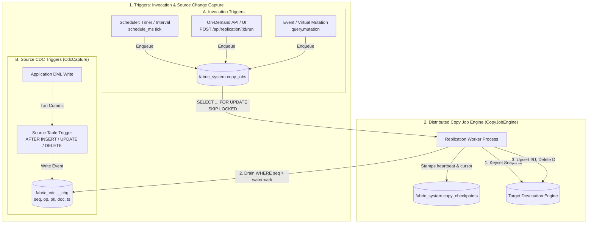
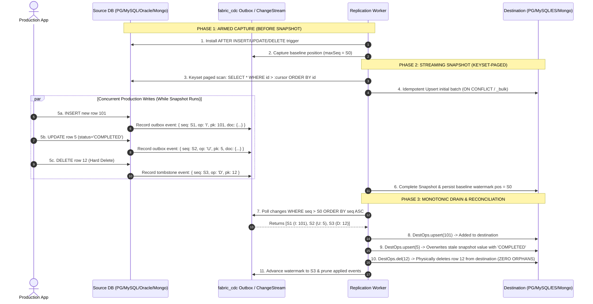

# Replication, Sync & the Copy-Job Microservice

Three things share the word "sync"; keep them distinct:

- **Inbound SYNC/CDC** (see [sync-and-cdc.md](sync-and-cdc.md)) copies a source **into the fabric hub** so the fabric can *query* it locally.
- **Replication** (this page) copies a source **into another data source** — a standalone
  copy you own, independent of the fabric's query engine. Destination is **PostgreSQL**
  ("replicate anything as Postgres"). Managed on the **Replication** page (`/replication`).
- **Disaster-recovery restore** replays a replica back into a chosen source.

All three are heavy row-copy work. The fabric does **not** run them inline — it *assigns
jobs* to a separate **replication-engine microservice** that executes them durably.

## Architecture — fabric assigns, microservice executes

```
                        assigns job                       claims (FOR UPDATE SKIP LOCKED)
 Data Fabric API  ───────────────────▶  fabric_system.copy_jobs  ◀───────────────────  replication-engine
 (POST sync/run/restore, schedulers)     (durable queue in the hub)                      (separate process/project)
                                                                                          • executes SYNC/CDC/REPLICATE/RESTORE
                                                                                          • checkpoints every batch
                                                                                          • heartbeat + pause/resume
```

- **`replication-engine/`** is a **separate top-level project** (its own `package.json`,
  like `trigger-engine/`). Run it with `npm --prefix replication-engine start`. It shares
  the fabric's connector + copy core by importing the backend modules (single source of
  truth — no logic drift).
- Set **`REPLICATION_ENGINE_EXTERNAL=true`** on the API so it does **not** also run an
  embedded worker (the API embeds one by default for dev convenience). Scale out by
  launching N engines with distinct `WORKER_ID`; `FOR UPDATE SKIP LOCKED` gives each job to
  exactly one worker.
- **Kinds:** `SYNC`, `CDC` (→ hub, via `PhysicalSync`), `REPLICATE`, `RESTORE`
  (source↔source, via `ReplicationService`).

## Enqueue → run → status

Every trigger returns immediately with a **run id** (HTTP `202 QUEUED`); the worker does
the copy. Poll `GET /api/replication/runs/:runId` for `status` + live progress.

| Method · path | Purpose |
|---|---|
| `POST /api/metadata/sync` | enqueue a SYNC (`mode:full`) or CDC (`mode:cdc`) into the hub |
| `POST /api/replication/:id/run` | enqueue a source→destination REPLICATE |
| `POST /api/replication/:id/restore` | enqueue a DR RESTORE (replica → `{targetSource}`) |
| `GET  /api/replication/runs` | list recent copy-job runs |
| `GET  /api/replication/runs/:runId` | one run's status/progress/result |
| `POST /api/replication/runs/:runId/pause` | request a pause (stops after the current batch) |
| `POST /api/replication/runs/:runId/resume` | resume a paused/failed run from its checkpoint |
| `GET  /api/replication/analytics` | aggregate analytics (rows copied, success rate, live % per active job) |

## Per-job configuration

Every job carries its own copy config, tunable at creation (stored on the replication job)
and overridable per run:

| Field | Meaning | Default (env) |
|---|---|---|
| `pageSize` | rows per read batch (memory ≈ one batch) | `FABRIC_COPY_BATCH` = 1000 |
| `memCeilingMb` | heap ceiling; a copy aborts before OOM | `FABRIC_COPY_MEM_CEILING_MB` = 1024 |
| `maxRows` | hard row cap per table | `FABRIC_COPY_MAX_ROWS` = 5,000,000 |

```bash
# Enqueue a full sync with a 500-row page size and 768MB ceiling
curl -s $BASE/api/metadata/sync -X POST -H "$AUTH" -H 'Content-Type: application/json' \
  -d '{"source":"Retail_Oracle","mode":"full","pageSize":500,"memCeilingMb":768}'
# → 202 { "status":"QUEUED", "runId":"..." }
```

## Progress & analytics (% completion)

Before copying a table the worker does a cheap `COUNT(*)` to seed the denominator; after
every committed batch it rolls the per-table checkpoints up onto the job row:
`rows_copied / rows_total`, `progress_pct`, `tables_done / tables_total`. The Replication
page shows live progress bars, throughput (rows/s), ETA, and a success-rate card.

## Durability — no data loss

Copies are **keyset-paginated** (`WHERE key > lastKey ORDER BY key`) rather than by OFFSET.
This is both crash-safe and concurrency-safe (see below). The last key doubles as a
**resume checkpoint** persisted per batch in `fabric_system.copy_checkpoints`.

- **Crash / restart** — a running job stamps `heartbeat_at` each batch. If a worker dies,
  the job is left RUNNING with a stale heartbeat; any worker (on startup and each tick)
  **reclaims** stale RUNNING jobs (`heartbeat_at` older than `FABRIC_COPY_STALE_MS`,
  default 60s) back to QUEUED. It is then re-claimed and **resumes mid-table from the last
  checkpoint** — finished tables are skipped, the in-progress table continues from its
  cursor, and boundary rows are re-applied via **upsert** (idempotent). Verified live:
  killed the engine mid-copy of an 80,000-row table at 30,000 rows; on restart it resumed
  and the destination ended with exactly 80,000 rows / 80,000 distinct keys — **no loss, no
  duplicates, no gaps**.
- **Pause / resume** — `control='PAUSE'` is probed between batches; the copy stops cleanly
  (status `PAUSED`, checkpoints kept) and `resume` continues from where it left off.
  Verified: paused a replication mid-copy, resumed, destination integrity intact.
- **Memory guard** — heap is sampled between batches; over the ceiling it tries GC then
  aborts that copy with a clear error instead of OOM-crashing (heap stayed ≈40–170MB for
  80k-row copies).
- **Retries** — a failed job is retried up to `max_attempts` (3), then `FAILED` with the
  error recorded. Handshake (`SELECT 1`) on the destination fails fast and cleanly.

## Triggers and Jobs in Replication: End-to-End Lifecycle

In Zero Data Fabric, **Triggers** and **Jobs** work together to create an asynchronous, crash-resilient, and drift-free replication pipeline.



### 1. How Triggers Come into the Picture

Triggers operate on two distinct planes in the replication architecture:

#### A. Source-Side DML Capture Triggers (`CdcCapture.ensure()`)
When a replication job is configured with `strategy = 'CDC'`, the engine connects to the source database and automatically installs native change capture triggers **before** reading any snapshot data:
- **PostgreSQL**: Installs a schema `fabric_cdc`, an outbox table `fabric_cdc.<schema>_<table>_chg`, and a PL/pgSQL function + trigger:
  ```sql
  CREATE TRIGGER <base>_cdc AFTER INSERT OR UPDATE OR DELETE ON <schema>.<table>
  FOR EACH ROW EXECUTE FUNCTION fabric_cdc.<base>_cdc_fn();
  ```
  Writes `(seq bigserial, op char(1), pk text, doc jsonb, ts timestamptz)` using `to_jsonb(NEW)` or `to_jsonb(OLD)`.
- **MySQL**: Installs `fabric_cdc_<schema>_<table>_chg` with `AUTO_INCREMENT seq` and three distinct triggers (`_cdc_i`, `_cdc_u`, `_cdc_d`) using `JSON_OBJECT(...)`.
- **Oracle (23c)**: Installs an outbox table with an `IDENTITY` sequence and a compound row trigger inserting JSON CLOBs for `INSERT`, `UPDATE`, and `DELETE`.
- **MongoDB**: Does not inject triggers; instead, it binds directly to MongoDB's native **Change Streams (oplog)** with cluster resume tokens.

**Why Triggers Are Indispensable for CDC**:
1. **Transactional Atomicity**: The outbox event is written in the exact same database transaction as the business application's write. If the application transaction rolls back, the change event vanishes — eliminating phantom updates.
2. **Hard Delete Tombstones**: Watermark queries (`WHERE updated_at > :wm`) cannot observe hard deletes because deleted rows no longer exist on disk. Triggers intercept the `DELETE` event and record a tombstone (`op = 'D'`).
3. **Monotonic Event Sequencing**: Physical database sequence generators (`bigserial`, `AUTO_INCREMENT`, `IDENTITY`) provide a monotonic integer `seq` that guarantees strict chronological replay.

#### B. Job Invocation Triggers (What Starts a Replication Job)
Replication jobs do not run continuously in memory; they are triggered by one of three execution mechanisms:
1. **Scheduled Interval Trigger (Timer)**:
   - Configured via `schedule_ms` on the replication job (e.g., `60000` for 1 minute).
   - `ReplicationService.startScheduler()` evaluates due jobs every `FABRIC_REPL_TICK_MS` (default 30s). When `now() - last_run_at >= schedule_ms`, it enqueues a copy job with `dedupe: true`.
2. **On-Demand / Manual API Triggers**:
   - Triggered by user action in the web console or automated CI/CD pipelines via:
     - `POST /api/replication/:id/run` (Source-to-source REPLICATE)
     - `POST /api/replication/:id/restore` (Disaster recovery RESTORE)
     - `POST /api/metadata/sync` (Hub-level SYNC/CDC)
   - Returns immediately with `HTTP 202 QUEUED` and a JSON payload containing `{ status: 'QUEUED', runId: '<uuid>' }`.
3. **Event-Driven Mutation Triggers**:
   - The Data Fabric's query engine emits `query.mutation` events when writes occur across virtual federated tables.
   - Mutation listeners and trigger rules evaluate these events and can enqueue immediate replication sync runs or invalidate caches.

---

### 2. How Jobs Come into the Picture (`CopyJobEngine`)

Replication tasks can involve copying millions of rows across high-latency networks. Running them inline in the API would cause request timeouts, thread pool starvation, and lost progress on server restart. Zero Data Fabric offloads all copy work to a dedicated job subsystem:

#### A. The Durable Job Queue (`fabric_system.copy_jobs`)
Every replication run is stored in PostgreSQL as a durable row containing:
- `id`: Unique execution UUID (`runId`).
- `kind`: `'REPLICATE'` (source→dest), `'RESTORE'` (replica→source), `'SYNC'` (source→hub), or `'CDC'` (continuous outbox drain).
- `status`: `'QUEUED'`, `'RUNNING'`, `'PAUSED'`, `'COMPLETED'`, or `'FAILED'`.
- `control`: `'RUN'` or `'PAUSE'`.
- `config`: Per-job limits (`pageSize`, `memCeilingMb`, `maxRows`).
- `heartbeat_at`: Live timestamp updated every batch.
- Live progress metrics: `rows_copied`, `rows_total`, `tables_done`, `tables_total`, `progress_pct`.

#### B. Distributed Claim via `FOR UPDATE SKIP LOCKED`
Workers in the `replication-engine` microservice run a polling loop (default every 2,000ms):
```sql
UPDATE fabric_system.copy_jobs SET status='RUNNING', control='RUN', attempts=attempts+1, claimed_by=$1,
  started_at=COALESCE(started_at, now()), heartbeat_at=now(), updated_at=now()
WHERE id = (
  SELECT id FROM fabric_system.copy_jobs
  WHERE status='QUEUED'
  ORDER BY created_at
  FOR UPDATE SKIP LOCKED
  LIMIT 1
) RETURNING *;
```
**Benefits for Enterprise Production**:
- **Concurrency-Safe**: $N$ horizontal worker instances can poll simultaneously without ever claiming the same job or blocking each other.
- **Fair Ordering**: Jobs are claimed FIFO by `created_at`.

#### C. Resumable Checkpoints (`fabric_system.copy_checkpoints`)
Each table tracks its state in `fabric_system.copy_checkpoints`:
- `(job_id, schema_name, table_name, cursor_value, rows_copied, total_rows, done)`
- Between batches, the worker checks `control`. If `control === 'PAUSE'`, it safely stops and transitions to `PAUSED`.
- When resumed via `POST /api/replication/runs/:runId/resume`, the worker loads the last `cursor_value` and continues using keyset pagination:
  `WHERE key > :cursor_value ORDER BY key ASC LIMIT :pageSize`.
- Finished tables are skipped. Re-applied boundary batches are idempotently handled via upsert primitives (`ON CONFLICT DO UPDATE`, `ON DUPLICATE KEY UPDATE`, `MERGE`, `_bulk`).

#### D. Crash Recovery & Stale Worker Reclaim
If a worker container crashes or experiences an unrecoverable network partition:
1. Its `heartbeat_at` stops advancing.
2. Healthy workers running `CopyJobEngine.reclaimStale()` scan for jobs where `status = 'RUNNING'` and `heartbeat_at < now() - 60000ms`.
3. The stale job is reclaimed back to `'QUEUED'`.
4. A healthy worker claims it, reads the checkpoints, and resumes mid-table without data loss or duplicate rows.

---

## Concurrent mutations during replication & Race-Free Reconciliation

What happens when data in production is actively changing — inserts, updates, and deletes — **while** replication is in progress?

### The Core Problem: The Snapshot-Mutation Race
In high-throughput enterprise databases, tables never freeze. While an initial snapshot of 10,000,000 rows is streaming:
1. Row 42 was read at 10:00:00. At 10:00:05, an application updates row 42 (`amount = 500`).
2. Row 85,000 has NOT yet been read. At 10:00:02, an application inserts row 85,000 and deletes row 12.
If replication simply dumps the table and polls later, it risks **silent data drift, stale overwritten values, or ghost/orphan records**.

### The Zero Data Fabric CDC Solution: Pre-Snapshot Outbox Arming + Monotonic Log Draining



### Why This Guarantees 100% Convergence (Zero Drift):
1. **Trigger Arms *Before* Reading Rows**: `CdcCapture.ensure()` executes before the first row is read. Any mutation occurring after $S_0$ is guaranteed to be logged in the outbox.
2. **Idempotent Destination Primitives (`DestOps`)**:
   - `INSERT` & `UPDATE` are applied as Upserts (`INSERT ... ON CONFLICT DO UPDATE` in PG, `ON DUPLICATE KEY UPDATE` in MySQL, `MERGE` in Oracle, `_bulk` / `replaceOne` in ES & MongoDB).
   - If a row was captured in the snapshot and *also* in an outbox update event, the outbox event safely overwrites the snapshot version with the newer state.
   - If a row was deleted during snapshot, the outbox tombstone (`op = 'D'`) issues `DestOps.del()`. If the row had made it into the snapshot, it is purged. If it wasn't in the snapshot, the delete is an idempotent no-op.
3. **Monotonic Sequence Ordering (`seq`)**: The outbox uses hardware-backed monotonic sequences (`bigserial`, MySQL `AUTO_INCREMENT`, Oracle `IDENTITY`). Events are replayed in the exact chronological commit order.
4. **Crash-Resilience & Checkpoint Resumption**: If the worker crashes mid-copy or mid-drain, it resumes from `fabric_system.copy_checkpoints` and the persisted CDC sequence watermark without missing changes or duplicating records.

---

## Strategy Comparison: FULL vs INCREMENTAL vs CDC

| Dimension | `FULL` (Copy All, Reload) | `INCREMENTAL` (Watermark) | `CDC` (Change Data Capture) |
| :--- | :--- | :--- | :--- |
| **How it queries** | Keyset scan of entire table (`WHERE id > :cursor`) | Polling current table state (`WHERE updated_at > :wm`) | Event log outbox (`WHERE seq > :lastSeq`) or MongoDB Change Stream |
| **Captures Inserts?** | ✅ Yes | ✅ Yes (advances watermark) | ✅ Yes |
| **Captures Updates?** | ✅ Yes | ✅ Yes (updates advance watermark) | ✅ Yes |
| **Captures Hard Deletes?** | ✅ Yes *(by dropping & reloading)* | ❌ **No (Mathematically Impossible)** | ✅ **Yes (Captures tombstones `op: 'D'`)** |
| **Why INCREMENTAL misses hard deletes** | N/A | When a row is hard-deleted, it physically vanishes from disk. `SELECT * WHERE updated_at > :wm` queries *existing* rows; it cannot find records that no longer exist. | Captures `OLD.pk` via `AFTER DELETE` trigger into an outbox table at the moment of deletion. |
| **Source Impact** | High read I/O during copy | Very low (indexed timestamp query) | Minimal (~2-3% DML overhead on source triggers) |
| **Destination State** | Complete fresh baseline | Cumulative with **orphan deleted rows** (unless soft deletes used) | Exact real-time mirror with zero orphans |
| **Recommended Use** | Initial migrations, disaster recovery | Append-only event feeds, logs, soft-delete tables | High-volume production transactional databases & ES search indexing |

---

Replication serves **two distinct purposes**, and the destination engine follows the intent:

- **Same-engine replica → Disaster Recovery.** Replicate a source into **another instance of
  the same engine** (Postgres→Postgres, **MySQL→MySQL**, **MongoDB→MongoDB**, Oracle→Oracle)
  so that on data loss you **restore back into the same engine type**. This is a faithful,
  own-it backup.
- **Elasticsearch → query accelerator.** Replicate any source into ES so the fabric serves
  fast search/aggregations from the ES copy, kept fresh by strategy (INCREMENTAL/CDC).

Per-engine destination writers (`modules/replication/dest_ops.ts` — all idempotent,
upsert-by-key, keyset-paged, resumable):

| Destination engine | Write path | Status |
|---|---|---|
| **PostgreSQL** | DDL + `INSERT … ON CONFLICT` upsert | ✅ (multi-schema mirror, tested) |
| **MySQL** | DDL (canonical→MySQL types) + `INSERT … ON DUPLICATE KEY UPDATE` | ✅ tested (MySQL→MySQL 5015 rows) |
| **MongoDB** | schemaless; `bulkWrite replaceOne upsert` by `_id`, `deleteOne` for CDC delete | ✅ tested (Mongo→Mongo + restore) |
| **Oracle** | DDL + `MERGE` (autoCommit) | ✅ tested (MySQL→Oracle 5015 rows) |
| **Elasticsearch** | `_bulk` index by `_id`; `dropIndex`/`deleteDoc` | ✅ (query accelerator) |

**DR restore targets any writable engine** (PostgreSQL, MySQL, MongoDB, Oracle) — it replays
the replica back into a chosen same-engine target. Verified: Mongo replica → Mongo target.

CDC applies to **any** destination via the same `DestOps` layer (unified `cdcRun`): verified
PG→PG (multi-schema, deletes), Mongo→ES (deletes), SQL→ES (deletes). Hub CDC (`PhysicalSync`)
is now **log-based full-CRUD** too — verified a source delete removed the hub row. CDC source
capture: PostgreSQL/MySQL/**Oracle** (trigger+outbox, all tested) and MongoDB (change streams);
Snowflake (Streams) is the remaining roadmap item. The `fabric_cdc` outbox schema/tables are
excluded from discovery (no recursive capture).

Elasticsearch specifics: each row is a document whose `_id` is the source PK; FULL drops the
index first (clean reload), INCREMENTAL indexes only rows past the watermark, CDC applies
deletes too.

**Why sync a DB into Elasticsearch?** To serve **fast search + aggregations** from the ES
copy instead of round-tripping to the source. Two flavours, same engine:

1. **Standalone ES replica** — pick a registered ES source as a replication destination on
   the Replication page. You own the copy.
2. **Fabric query accelerator** — full-sync a DB's tables into ES, then the fabric queries
   those indices (ES is a first-class fabric source) for full-text and terms/percentile
   aggregations. Do an initial **"sync whole"** (FULL) to load everything, then keep it
   fresh with **INCREMENTAL** (smart watermark) and/or the live `ElasticsearchMutationWorker`
   mirror.

Verified live: `Retail_MySQL → ES` full sync = 5005 docs (`_id` = source id), terms agg on
the copy returns per-category counts; `An_Lab (Mongo) → ES` = 52,036 docs; INCREMENTAL after
inserting 2 rows indexed **exactly 2** (5005 → 5007).

## Keeping ES correct for FULL CRUD — true CDC (inserts, updates, **deletes**)

Watermark polling (`WHERE updated_at > x`) can't see **deletes** and misses updates on
tables without an update-timestamp. For a copy that faithfully mirrors every row-level
change — the real-life ES pattern — use the **`CDC` strategy**, which is *trigger + outbox*
change capture (what Debezium does off the WAL, done here with a source trigger):

1. **Snapshot** — first run marks the current log position, clean-reindexes the current rows,
   and baselines the sequence.
2. **Stream** — each later run drains the change-log (`WHERE seq > lastSeq ORDER BY seq`) and
   applies every operation in order: **INSERT/UPDATE → upsert by `_id`, DELETE → delete by
   `_id`**. `seq` is a monotonic sequence, so nothing is missed and deletes are captured.

**CDC is per-engine — the fabric provides a native capture provider for each** (not one
mechanism). The downstream (snapshot → change events → apply I/U as upsert, D as delete →
optional Kafka) is shared; only *capture* differs:

| Source engine | Native CDC capture | Status |
|---|---|---|
| **PostgreSQL** | trigger + outbox (`to_jsonb`) | ✅ done + tested (also logical-replication = future) |
| **MySQL** | trigger + outbox (`JSON_OBJECT`) | ✅ implemented (binlog = future) |
| **MongoDB** | **change streams** (`watch`, resume token) — reads the oplog, no triggers | ✅ done + tested (needs a replica set) |
| **Oracle** | LogMiner / trigger fallback | roadmap |
| **Snowflake** | Streams (native CDC objects) | roadmap |
| **Elasticsearch** | `_seq_no` poll (source rare) | roadmap; usually a sink |

Trigger-based capture installs `fabric_cdc.<table>_chg` on the source on first run (needs
write access). MongoDB uses change streams with a persisted resume token (crash-safe:
resume from the last token, idempotent apply). Engines without a provider **fail gracefully**
with an actionable message ("use scheduled SYNC or INCREMENTAL"). Verified live: Mongo →
change streams → ES applied insert/update/**delete** (o1 removed) correctly. Verified live (Postgres → ES): snapshot 3 rows, then on the source
`INSERT id4 / UPDATE id2 / DELETE id1` → after one drain the ES index had id2 updated, id4
added, and **id1 gone** — full CRUD including the delete.

### Kafka-backed CDC (production-grade, memory-safe, no-loss-on-restart)

Set `FABRIC_CDC_VIA_KAFKA=true` to route CDC through **Kafka** (the durable delivery backbone):

```
Source ─(trigger+outbox)→ PRODUCER ──▶ Kafka topic cdc.<tenant>.<source> ──▶ CONSUMER ──▶ ES
         durable capture   drains in     durable, replicated, replayable       applies + commits
         (source txn)      bounded batches   (on disk)                          offset AFTER apply
```

- **Producer** (runs during a CDC job's scheduled/queued run, in the replication-engine): drains the source outbox in bounded batches, publishes with `acks=all`, advances its offset **only after Kafka acks**, then prunes the outbox.
- **Consumer** (long-lived in the replication-engine, one group per CDC→ES job): reads Kafka in bounded batches, applies I/U→upsert and **D→delete** by `_id`, and **commits the offset only after apply** — at-least-once + idempotent = effectively exactly-once effect.

**Failure / restart — nothing is lost (verified live):**

| Failure | Where the backlog waits | On restart |
|---|---|---|
| Consumer down, Kafka up | Kafka log (**disk**) | resumes from committed offset |
| Producer / whole engine down | source outbox (**disk, in the source DB**) | producer drains it → Kafka → consumer |
| Both + Kafka down | source outbox (**disk**) | full chain drains in order |

Two durable checkpoints (outbox `seq`, Kafka consumer offset), each advanced only after the next hop succeeds. **Verified:** killed the entire replication-engine, did `INSERT id6 / DELETE id4` on the source *while it was down* (captured in the outbox), restarted → ES ended at exactly `[3,5,6]` — id4 deleted, id6 inserted, **zero loss, zero dup**.

**Memory:** every hop reads a **bounded batch** (`LIMIT` on the outbox, Kafka fetch size on the consumer), so process heap is O(batch), never O(backlog). A slow/down consumer grows the **Kafka log on disk**, not fabric memory; a down producer grows the **source outbox on disk**. Nothing accumulates in the fabric's heap regardless of how long anything is down.

**CRUD capture by strategy (corrected, honest):**

| Strategy | Create | Update | Delete | Cost |
|---|---|---|---|---|
| `FULL` (scheduled reload) | ✅ | ✅ | ✅ | re-copies everything each run |
| `INCREMENTAL` (watermark) | ✅ | ✅ *iff `updated_at`* | ❌ | cheap deltas; no deletes |
| **`CDC` (trigger+outbox)** | ✅ | ✅ | ✅ | cheap deltas; installs a source trigger |
| Live mirror (fabric writes only) | ✅ | ✅ | ✅ | instant, but only for `/api/data` writes |

> Note: replication copies **every table** of a source, so `CDC` installs a trigger on each.
> Per-table scoping (choose exactly which tables get CDC) is a planned refinement.

## Smart change-tracking (auto-detected)

You don't have to name the watermark column. `analyzeTracking(columns)` inspects each table
and picks:

- **key column** — the PK (for keyset paging, resume cursor, and dedupe/upsert).
- **watermark column** — best available signal of change, in priority order:
  1. an **update timestamp** (`updated_at`, `modified`, `last_modified`, `*_at`) → captures
     **inserts + updates**;
  2. a **creation timestamp** (`created_at`) → captures inserts;
  3. an **auto-increment id / sequence** → captures **inserts only** (updates/deletes need a
     FULL run);
  4. none → the table can only be FULL-reloaded.

Preview it per source: `GET /api/replication/tracking?source=<name>` returns, for every table,
the chosen `keyCol`, `watermarkCol`, what it `captures`, the candidate columns, and a
plain-English `reason` (e.g. *"no timestamp; chose auto-increment id 'id' → captures new
inserts only"*). INCREMENTAL replication uses this automatically when `cdcColumn` is unset.

## What tracks the resume position — and the edge cases

Resume/pause is tracked by a **key column** = the table's **primary key** (`pkCols[0]`), stored
in `copy_checkpoints.cursor_value` (one continuously-updated row per table — not per batch;
you only need the *latest* cursor to resume). Keyset paging advances `WHERE key > cursor`.

- **No primary key** → we cannot position deterministically or dedupe, so a keyless table
  is **not** resumed mid-way (that would risk duplicates). On crash it **restarts from
  scratch** (table-level, DROP+reload) — safe, at the cost of re-copying that one table.
- **Typed keys (Mongo `ObjectId`)** → the persisted cursor is a hex string; the Mongo
  connector coerces a 24-hex-char `_id` filter back to `ObjectId` on resume, so keyset
  continues correctly (verified: killed mid-copy of a 40,000-doc collection, resumed to
  exactly 40,000 / 40,000 distinct — no loss, no dup).
- **Already-copied rows deleted from the *destination* mid-crash** → resume is forward from
  the cursor and does **not** re-scan the replica (a churning source would make any count
  check force needless full reloads). We only rebuild a table if it was **entirely dropped**.
  To fully reconcile external replica edits, trigger a fresh FULL run (a new run id ⇒ clean
  rebuild) or use INCREMENTAL/CDC.
- **A re-run is always clean**: each user-triggered run is a new `copy_jobs` id with its own
  checkpoint namespace, so "Run" rebuilds from scratch; only a crash *reclaim* (same id)
  resumes.

## Scope — what is and isn't copied

Replication (and hub SYNC) copy **table DATA only** (`resourceType = TABLE`). **Views,
functions, procedures, sequences, and triggers are NOT byte-copied** — cross-engine
procedural code (Oracle PL/SQL ≠ Postgres PL/pgSQL) isn't portable, and these are
**fabric-managed logical objects**: sequences/functions/triggers/policies/constraints applied
via a **manifest** live in the fabric control plane + hub and are reproduced by **re-applying
the manifest** to the target, not by data replication. So: back up *data* with replication;
back up *logic* with the manifest.

## Replication job model

A **replication job** = `{ name, source, destination, mode, strategy, destSchema, cdcColumn?, scheduleMs?, copyConfig? }`,
stored in `fabric_system.replication_jobs`.

| Field | Values | Meaning |
|---|---|---|
| `mode` | `ONE_WAY` (today) · `TWO_WAY` (modelled, deferred) | direction |
| `strategy` | `FULL` · `INCREMENTAL` | full reload vs watermark upsert |
| `destSchema` | schema name (default `public`) | where tables land in the destination |
| `cdcColumn` | column | watermark for `INCREMENTAL` |
| `scheduleMs` | ms | auto-run cadence (blank = manual) |
| `copyConfig` | `{pageSize,memCeilingMb,maxRows}` | per-job copy tuning |

Scheduled jobs are **also** assigned to the microservice (the scheduler enqueues, deduped —
it never runs the copy inline).

## Verified end-to-end

- Oracle → hub SYNC via the microservice: 5,005 rows, live progress 10%→100%, keyset-paged.
- Oracle → Postgres REPLICATE (85,005 rows) + DR RESTORE, heap ≈41MB.
- Crash mid-copy → restart → resume from checkpoint → exact row count, zero duplicates.
- Pause mid-copy → PAUSED → resume → COMPLETED with intact destination.
- Failure path: bogus source retried 3× then FAILED with the error recorded.

## Limits (honest)

- **Destination = PostgreSQL only** today. Other destination engines are future.
- **ONE_WAY only.** TWO_WAY (bidirectional + conflict resolution) is modelled but deferred.
- INCREMENTAL is watermark-based (captures inserts + watermark-advancing updates, not hard
  deletes).
