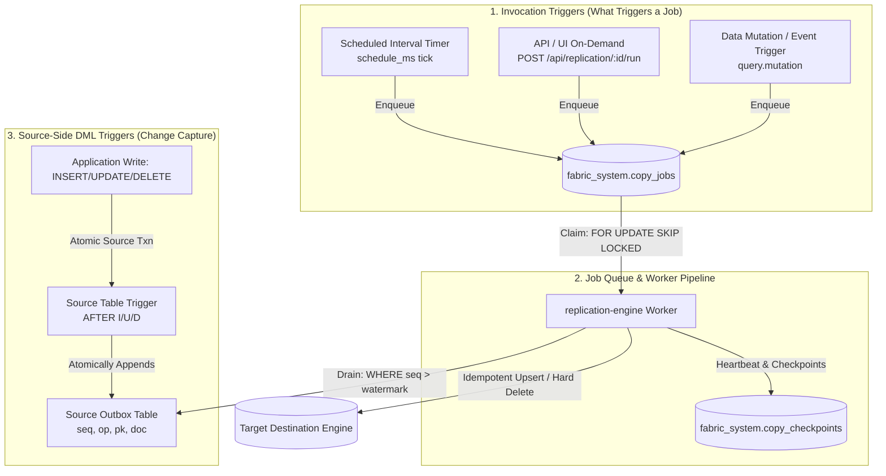

# 19 · Replication-Engine Microservice (Sync / CDC / Replication / DR)

## Why a separate service

Physical SYNC, CDC refresh, source→source replication, and disaster-recovery restore are
all **long-running, memory-heavy row copies**. Running them inside the API process would
block request threads, couple copy throughput to API capacity, and lose all progress if the
API restarts mid-copy. So the fabric follows the same pattern as `trigger-engine`: the API
**assigns jobs**; a dedicated **replication-engine** microservice **executes** them.

```
 ┌─────────────────┐   enqueue (202 QUEUED)   ┌──────────────────────────┐   claim: FOR UPDATE SKIP LOCKED
 │  Data Fabric API │ ───────────────────────▶ │ fabric_system.copy_jobs  │ ◀──────────────────────────────┐
 │  · POST /metadata/sync                        │  (durable queue, hub DB) │                                 │
 │  · POST /replication/:id/run|restore          └──────────────────────────┘                                 │
 │  · schedulers (enqueue, deduped) │                        │  rolls up progress                             │
 └─────────────────┘                                         ▼                                                 │
                                              fabric_system.copy_checkpoints  ◀── save() each batch ── replication-engine (N workers)
                                              (per-table cursor+rows+done)          · PhysicalSync (SYNC/CDC → hub)
                                                                                    · ReplicationService (REPLICATE/RESTORE)
                                                                                    · keyset paging, memory guard, heartbeat
```

- **Separate project** `replication-engine/` (own `package.json`/`tsconfig`), started with
  `npm --prefix replication-engine start` (`--expose-gc` for the memory guard). It imports
  the backend's connector + copy core so there is a single source of truth.
- **Embedded fallback:** the API runs an in-process worker by default (dev). Set
  `REPLICATION_ENGINE_EXTERNAL=true` to disable it and use the dedicated service.
- **Horizontal scale:** launch many workers with distinct `WORKER_ID`. `FOR UPDATE SKIP
  LOCKED` guarantees each job is claimed by exactly one worker.

## Job lifecycle

```
QUEUED ──claim──▶ RUNNING ──ok──▶ COMPLETED
   ▲                 │ error(<max) ─▶ QUEUED (retry)
   │                 │ error(=max) ─▶ FAILED
   │                 │ control=PAUSE ─▶ PAUSED ──resume──▶ QUEUED
   └──── reclaim (stale heartbeat) ◀── RUNNING (worker died)
```

Statuses live on `copy_jobs`; `control` (RUN/PAUSE) is the pause request flag; `heartbeat_at`
drives crash detection.

## Bounded-memory, resumable copy (`modules/sync/copy_util`)

- **Keyset paging** `WHERE key > lastKey ORDER BY key ASC LIMIT n` (Postgres `LIMIT`,
  Oracle `FETCH FIRST n ROWS ONLY`, etc.). Memory ≈ one page. The `lastKey` is the resume
  cursor. Falls back to OFFSET only when a table has no usable key.
- **Memory guard** samples heap between batches; over `memCeilingMb` it GCs then aborts that
  copy cleanly (no OOM).
- **Hard row cap** (`maxRows`) stops a runaway read.
- **Per-job config** `{pageSize, memCeilingMb, maxRows}` threaded from the queued job.

## Durability guarantees

| Failure | Mechanism | Result |
|---|---|---|
| Worker/host crash mid-copy | `heartbeat_at` goes stale → `reclaimStale()` requeues → resume from `copy_checkpoints` | finished tables skipped; in-progress table continues from cursor; boundary batch re-applied via **upsert** → no loss, no dup |
| User pause | `control=PAUSE` probed between batches → `CopyPaused` | status `PAUSED`, checkpoints kept; `resume` continues |
| Transient error | retry to `max_attempts` | then `FAILED` with error recorded |
| Unreachable destination | handshake `SELECT 1` before copy | fails fast, connectors closed |
| Large table | keyset paging + memory guard | heap bounded (≈40–170MB in tests) |

## Triggers in the Replication Architecture

Triggers serve two distinct, mission-critical roles in the replication lifecycle:



### 1. Source-Side DML Change Capture Triggers (`CdcCapture.ensure()`)
When a replication job is configured with `strategy: 'CDC'`, the engine automatically provisions native database triggers on the source tables **before** running the snapshot:
- **PostgreSQL**: Single `AFTER INSERT OR UPDATE OR DELETE` row-level trigger that executes `to_jsonb(NEW/OLD)` into `fabric_cdc.<schema>_<table>_chg` with a monotonic `bigserial seq`.
- **MySQL**: Three distinct triggers (`_cdc_i`, `_cdc_u`, `_cdc_d`) packaging fields into `JSON_OBJECT(...)` written to `fabric_cdc_<schema>_<table>_chg` with `AUTO_INCREMENT seq`.
- **Oracle**: Compound trigger (`AFTER INSERT OR UPDATE OR DELETE`) serializing to JSON CLOB into an outbox table with an `IDENTITY` sequence.
- **MongoDB**: Utilizes native MongoDB Change Streams / Oplog with resume tokens instead of triggers.

**Why Triggers Are Used for CDC**:
1. **Transactional Atomicity**: The outbox record commits or rolls back in the exact same transaction as the application write — zero ghost writes.
2. **Hard Delete Tombstones**: Watermark queries (`WHERE updated_at > :wm`) cannot observe hard deletes because deleted rows no longer exist on disk. The trigger intercepts `DELETING` and persists a tombstone (`op = 'D'`).
3. **Monotonic Sequence**: Guarantees strictly ordered chronological replay without relying on clock synchronization.

### 2. Job Invocation Triggers (What Starts a Replication Job)
- **Time/Interval Triggers (`schedule_ms`)**: `ReplicationService.startScheduler()` runs every `FABRIC_REPL_TICK_MS` (default 30s). When `now() - last_run_at >= schedule_ms`, it enqueues a job into `fabric_system.copy_jobs` with `dedupe: true`.
- **On-Demand / Manual API Triggers**: `POST /api/replication/:id/run` or `POST /api/replication/:id/restore` enqueues an execution and immediately returns HTTP `202 QUEUED` with the unique `runId`.
- **Event-Driven Mutation Triggers**: Virtual mutations emitted by the Data Fabric query orchestrator (`query.mutation`) trigger cache/ES mutation listeners.

---

## The Copy Job Subsystem (`CopyJobEngine`)

Replication is never executed inline in the API request cycle. It is managed by a durable, multi-worker distributed job system:

1. **Durable Queue (`fabric_system.copy_jobs`)**:
   Holds execution state: `id` (run UUID), `kind` (`REPLICATE`, `SYNC`, `CDC`, `RESTORE`), `status` (`QUEUED`, `RUNNING`, `PAUSED`, `COMPLETED`, `FAILED`), `control` (`RUN`, `PAUSE`), `config` (`pageSize`, `memCeilingMb`, `maxRows`), `heartbeat_at`, and progress rollups.

2. **Distributed Claim via `FOR UPDATE SKIP LOCKED`**:
   Any number of worker processes can scale horizontally. Each worker claims the next available job atomically:
   ```sql
   UPDATE fabric_system.copy_jobs SET status='RUNNING', control='RUN', attempts=attempts+1, claimed_by=$1,
     started_at=COALESCE(started_at, now()), heartbeat_at=now(), updated_at=now()
   WHERE id = (SELECT id FROM fabric_system.copy_jobs WHERE status='QUEUED' ORDER BY created_at FOR UPDATE SKIP LOCKED LIMIT 1)
   RETURNING *;
   ```
   No two workers can ever claim the same job, and workers never block each other.

3. **Batch Checkpointing (`fabric_system.copy_checkpoints`)**:
   After each committed batch (default 1,000 rows), the worker persists the table's keyset cursor (`WHERE key > cursor ORDER BY key ASC`) and rolls up `rows_copied / rows_total` and `progress_pct`.

4. **Crash Recovery & Stale Lease Reclaim**:
   Workers stamp `heartbeat_at` on every batch. If a worker dies or is terminated, `CopyJobEngine.reclaimStale()` identifies jobs where `heartbeat_at < now() - STALE_MS` (default 60s) and resets them to `'QUEUED'`. The next worker resumes execution from the exact checkpoint cursor without data loss or duplication.

5. **Pause & Resume**:
   Users can pause a live job via `POST /api/replication/runs/:runId/pause`. The worker checks `shouldStop()` between batches, sets status to `PAUSED`, and keeps checkpoints intact. Resuming via `POST /api/replication/runs/:runId/resume` re-queues the job to continue from its cursor.

---

## Concurrent mutations during a copy & CDC CRUD Reconciliation

## Progress & analytics

`save()` seeds `total_rows` (a cheap `COUNT(*)`) then, per batch, rolls checkpoints up onto
the job: `rows_copied/rows_total`, `progress_pct`, `tables_done/tables_total`, plus
`heartbeat_at`. `GET /api/replication/analytics` aggregates success rate, total rows, and
per-active-job live % + throughput + ETA for the Replication dashboard.

## Data sources & Destination Engines

All major engines are supported across the fabric: **PostgreSQL, MySQL, MongoDB, Elasticsearch, Snowflake, and Oracle Database**.
- **Source Capture**: PostgreSQL (trigger + `to_jsonb`), MySQL (trigger + `JSON_OBJECT`), Oracle (trigger + `JSON_OBJECT`), MongoDB (native change streams / oplog).
- **Destination Engines**: PostgreSQL (multi-schema DDL + upsert), MySQL (DDL + `INSERT ... ON DUPLICATE KEY UPDATE`), MongoDB (`bulkWrite` replaceOne / deleteOne), Oracle (DDL + `MERGE`), Elasticsearch (`_bulk` index by `_id` / `deleteDoc`).
- **DR Restore**: Targets any writable database engine to replay replicas cleanly back into the source.

## Key env

`REPLICATION_ENGINE_EXTERNAL`, `WORKER_ID`, `FABRIC_COPY_POLL_MS` (2000),
`FABRIC_COPY_STALE_MS` (60000), `FABRIC_COPY_BATCH` (1000),
`FABRIC_COPY_MEM_CEILING_MB` (1024), `FABRIC_COPY_MAX_ROWS` (5,000,000).
